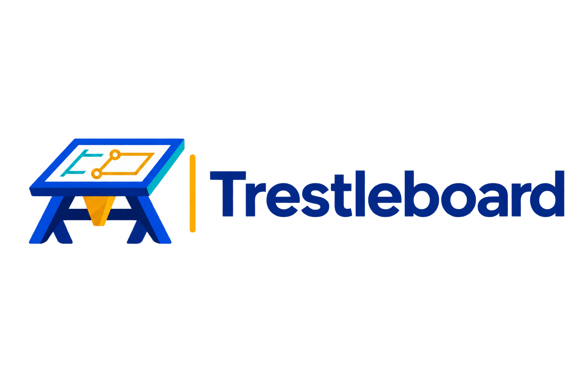

<p align="center">
  
</p>

<h1 align="center">Trestleboard</h1>

<p align="center">
  <strong>Capture organizational knowledge through structured, AI-guided solution delivery</strong>
</p>

<p align="center">
  <a href="#overview">Overview</a> •
  <a href="#the-real-value">The Real Value</a> •
  <a href="#personas">Personas</a> •
  <a href="#quick-start">Quick Start</a> •
  <a href="#workflow">Workflow</a> •
  <a href="#project-structure">Structure</a>
</p>

---

## Overview

> **Designed for CLI Tools:** Trestleboard is built for AI CLI tools (Claude CLI, Gemini CLI, GitHub Copilot CLI) that support system prompts and filesystem access. These tools can load personas directly and read/write artifacts automatically. While the personas work in web interfaces, you'll need to manually handle artifact chaining.

Trestleboard uses AI-powered personas to guide you through software solution delivery—but **the real value isn't the workflow, it's the knowledge you capture along the way.**

Every project generates consistent, structured artifacts: business context, technical specifications, architectural decisions, risk assessments. Over time, this becomes a queryable corpus of your organization's collective intelligence.

### How It Works

AI personas guide you through three phases (plus a Quality persona that reviews the result), prompting questions you might not think to ask:

| Phase | Persona | Output |
|-------|---------|--------|
| **Discovery** | Analyst | Agile Inception Deck |
| **Design** | Solution Architect | Technical Specification |
| **Delivery** | Paired Developer | Working Software |
| **Assurance** | Quality | Quality Report (test strategy, findings, consistency checks) |

Each persona produces both human-readable markdown and machine-readable JSON. The markdown is for you; the JSON is for knowledge graphs, search indexes, and future AI-assisted discovery.

---

## The Real Value

### Consistent Documentation
The personas guide thorough discovery, ensuring you capture decisions, risks, and rationale that often go undocumented. Every project follows the same structure—no more reinventing templates or forgetting key questions.

### Prompted Thoroughness
The personas ask what you might not think to ask. Why are we building this? What's explicitly out of scope? What are the risks? What architectural decisions did we make, and why? This discipline produces better software.

### Organizational Knowledge Capture
**This is where it gets powerful.** Every project produces structured JSON artifacts with consistent schemas:

- Query across projects: *"What risks have we seen in e-commerce projects?"*
- Feed into RAG systems: *"Have we solved a problem like this before?"*
- Build knowledge graphs: Connect decisions, technologies, and outcomes
- Pattern recognition: Common technology choices, recurring risks, estimation accuracy
- Onboarding: New team members explore past projects in a consistent format

The filesystem structure (`projects/<name>/input/` and `output/`) is one way to organize this locally. But the real opportunity is what you can do with this structured data at scale—knowledge graphs, organizational search, AI-assisted project discovery. More to come.

### Orchestrated but Modular
The personas are designed as a workflow—Analyst feeds Solution Architect feeds Paired Developer—but each stands on its own. You don't have to use the full pipeline:

- Need help creating an Inception Deck for a project already in flight? Just use the Analyst.
- Want architectural guidance without the discovery phase? Start with the Solution Architect.
- Have a spec and need a disciplined pair programmer? Jump straight to the Paired Developer.

Use them as a complete workflow, or consult individual personas for specific tasks.

### A Way to Start with AI
If you're curious about working with AI but unsure where to begin, Trestleboard provides structure. The personas guide structured conversations rather than open-ended prompting, so you always know what to ask next. You'll learn:

- How to have productive conversations with AI tools
- What good prompts look like (the personas *are* the prompts)
- How AI can augment your thinking without replacing your judgment
- When to trust AI output and when to push back

This is a learning tool as much as a productivity tool. Start here, build confidence, then take what you've learned to other AI interactions.

### Your Collaborative Coach
The personas don't just generate artifacts—they coach you through the process of building software. They ask probing questions, challenge assumptions, and guide you through established methodologies step by step. Think of them as experienced colleagues who help you think through problems, not just tools that produce output.

---

### Features

- **AI-Agnostic**: Personas are markdown files usable with any AI tool (Claude, ChatGPT, Gemini, etc.)
- **Structured Output**: Every artifact has both markdown (human) and JSON (machine) formats
- **JSON Schemas**: Validate and query artifacts programmatically
- **Artifact Chaining**: Each persona's output feeds the next persona's input
- **Contradiction Detection**: Downstream personas flag upstream inconsistencies
- **Mustache Templates**: Consistent, repeatable artifact generation
- **Test-Driven Development**: Paired Developer enforces TDD discipline

---

## Personas

### 🔍 Analyst

Facilitates discovery conversations to build a complete **Agile Inception Deck** (10 sections):

1. Why Are We Here?
2. Elevator Pitch
3. Product Box
4. NOT List
5. Meet the Neighbors
6. Show the Solution
7. Risks
8. Sizing
9. Tradeoffs
10. What It Takes

**Output**: `inception-deck.md` + `inception-deck.json`

### 🏗️ Solution Architect

Transforms the Inception Deck into a **Technical Specification**:

- Use Cases (actors, flows, exceptions)
- C4 Diagrams (Context, Container, Component) in Mermaid
- Wireframes (ASCII/Mermaid)
- Architectural Decision Records (ADRs)

**Output**: `specification.md` + `specification.json`

### 👥 Paired Developer

Implements the solution collaboratively using **strict TDD**:

- Smallest possible increments
- Test-first development (Red-Green-Refactor)
- Short-lived feature branches
- PR approval before merge
- Demo after each value wave

**Output**: Working software + `task-breakdown.md` + code review checklists

### ✅ Quality

An expert in automated testing and project consistency:

- Reviews test strategy against the test pyramid, and test quality (flakiness, over-mocking, coverage that proves nothing)
- Checks that artifacts, code and conventions agree with each other
- Runs `npm run lint` to check Trestleboard's own personas, templates and schemas for consistency

**Output**: `quality-report.md` + `quality-report.json`

---

## Customizations

Add your own personas, extend or replace the built-in ones, and register new document formats and data files, without editing Trestleboard itself.

1. Set `customizations.enabled: true` in `trestleboard.yaml`
2. Run `npm run customize -- init` to create `config/customizations/` from the examples in `config/customizations.example/`
3. Rename an example (remove the leading `_`) and edit it

| Persona `mode` | Effect |
|----------------|--------|
| `add` | A new persona |
| `override` | Replaces the built-in persona with the same `id` |
| `overload` | Merges your `##` sections into the built-in persona (replace, append or prepend) |

New document formats (templates) and data files (JSON schemas, usable with `tb-validate --schema <id>`) are registered in `config/customizations/customizations.yaml`.

`config/customizations/` is gitignored here so your team can track it in its own repository. If customization files exist while the setting is off, tools warn that they are being ignored; if the setting is on and the folder is empty, you are offered the examples. Every persona starts with a YAML `persona:` front matter block, which `npm run lint` checks.

---

## Quick Start

See [QUICKSTART.md](QUICKSTART.md) for detailed setup instructions.

### Prerequisites

- Any AI CLI tool (Claude, Gemini, or GitHub Copilot CLI)
- Git (for version control with Paired Developer)

> **Note:** Trestleboard is designed for **AI CLI tools** that support system prompts and have filesystem access. Web interfaces (Claude.ai, ChatGPT, etc.) can use the personas but lack the automated artifact chaining workflow. For the full experience, use a CLI tool.

### Basic Usage

1. **Clone this repository**
   ```bash
   git clone <repository-url>
   cd Trestleboard
   ```

2. **Start with the Analyst** (choose your preferred CLI)
   ```bash
   # Using Claude CLI
   claude --system-prompt personas/analyst.md

   # Using Gemini CLI
   gemini --system-instruction "$(cat personas/analyst.md)"

   # Using GitHub Copilot CLI
   gh copilot explain --system-prompt personas/analyst.md
   ```

3. **Progress through personas** as artifacts are completed

---

## AI CLI Tools

Trestleboard is **AI-agnostic**. Use whichever CLI tool you prefer:

### Claude CLI (Anthropic)

**Install:**
```bash
# Via npm
npm install -g @anthropic-ai/claude-code

# Via Homebrew (macOS)
brew install claude
```

**Authenticate:**
```bash
claude auth login
# Or set environment variable
export ANTHROPIC_API_KEY=your-api-key
```

**Usage with Trestleboard:**
```bash
# Start with a persona
claude --system-prompt personas/analyst.md

# Work in a specific project directory
claude --system-prompt personas/paired-developer.md --cwd projects/my-project
```

**Documentation:** [Claude CLI Docs](https://docs.anthropic.com/en/docs/claude-cli)

**Tip: Watch the AI Reason**

If you're learning the methodologies (Inception Decks, C4 diagrams, TDD), consider enabling visible reasoning to see *how* the AI thinks through each step:

- **Toggle thinking**: `Option + T` (macOS) or `Alt + T` (Windows/Linux)
- **Expand full reasoning**: `Ctrl + O`

Watching the reasoning process helps you internalize the frameworks and learn to ask better questions yourself.

---

### Gemini CLI (Google)

**Install:**
```bash
# Via npm
npm install -g @anthropic-ai/gemini-cli

# Or download from Google
curl -sSL https://sdk.cloud.google.com | bash
```

**Authenticate:**
```bash
# Using Google Cloud authentication
gcloud auth login

# Or set API key
export GEMINI_API_KEY=your-api-key
```

**Usage with Trestleboard:**
```bash
# Start with a persona (inline system instruction)
gemini --system-instruction "$(cat personas/analyst.md)"

# Interactive mode with persona
gemini chat --system-instruction "$(cat personas/solution-architect.md)"
```

**Documentation:** [Gemini CLI Docs](https://cloud.google.com/vertex-ai/docs/generative-ai/gemini-cli)

---

### GitHub Copilot CLI

**Install:**
```bash
# Requires GitHub CLI first
brew install gh

# Then install Copilot extension
gh extension install github/gh-copilot
```

**Authenticate:**
```bash
gh auth login
```

**Usage with Trestleboard:**
```bash
# Use with explain command
gh copilot explain --system-prompt personas/analyst.md

# Interactive suggest mode
gh copilot suggest --system-prompt personas/paired-developer.md
```

**Note:** GitHub Copilot CLI integration may vary. You can also paste persona content directly into GitHub Copilot Chat in VS Code or other IDEs.

**Documentation:** [GitHub Copilot CLI Docs](https://docs.github.com/en/copilot/github-copilot-in-the-cli)

---

### Loading Personas in CLI Tools

Once inside a CLI tool session, you can load a persona dynamically:

```
Load System Prompt personas/analyst.md
```

This allows you to switch personas mid-session without restarting the CLI.

---

### Alternative: Web Interfaces

If you prefer web interfaces, copy the persona file contents and paste as your first message:

| Tool | How to Use |
|------|-----------|
| **Claude.ai** | "Please adopt this persona: [paste persona]" |
| **ChatGPT** | "Use this as your system prompt: [paste persona]" |
| **Gemini Web** | "Act according to these instructions: [paste persona]" |
| **GitHub Copilot Chat** | Paste persona in VS Code Copilot Chat |

**Note:** Web interfaces lack filesystem access, so the artifact chaining workflow (reading from `input/` and writing to `output/` directories) will not work. You'll need to manually copy artifact content between sessions. For the full automated workflow, use CLI tools instead.

---

### IDE Integrations

Many IDEs support AI assistants with custom instructions:

| IDE | Integration |
|-----|-------------|
| **VS Code** | GitHub Copilot Chat, Continue.dev |
| **JetBrains** | AI Assistant, GitHub Copilot |
| **Cursor** | Built-in AI with custom prompts |
| **Zed** | Claude integration |

Load personas by copying content into the assistant's system prompt or custom instructions setting.

---

## Workflow

```
┌─────────────────────────────────────────────────────────────────────┐
│                           ANALYST                                    │
│  Input:  User-provided documents, conversations                     │
│  Output: output/ → copies to input/                                  │
└──────────────────────────────┬──────────────────────────────────────┘
                               │
                               ▼
┌─────────────────────────────────────────────────────────────────────┐
│                      SOLUTION ARCHITECT                              │
│  Input:  input/inception-deck.md                                    │
│  Output: output/ → copies to input/                                  │
└──────────────────────────────┬──────────────────────────────────────┘
                               │
                               ▼
┌─────────────────────────────────────────────────────────────────────┐
│                       PAIRED DEVELOPER                               │
│  Input:  input/inception-deck.md + input/specification.md          │
│  Output: output/ + working code                                      │
└─────────────────────────────────────────────────────────────────────┘
```

### Artifact Flow

Each persona:
1. Reads from `projects/<project>/input/`
2. Writes to `projects/<project>/output/<phase>/`
3. Copies artifacts to `input/` for downstream personas

### Contradiction Handling

If a downstream persona detects contradictions with upstream artifacts:
1. Documents the contradiction
2. Logs to `contradiction-log.json`
3. Recommends re-engaging the upstream persona
4. Does NOT proceed with conflicting assumptions

---

## Project Structure

```
Trestleboard/
├── README.md
├── QUICKSTART.md
├── trestleboard.yaml          # Configuration (storage backend, paths)
├── Trestleboard.png
│
├── personas/
│   ├── analyst.md              # Discovery & Inception Deck
│   ├── solution-architect.md   # Technical Specification
│   ├── paired-developer.md     # TDD Implementation
│   └── quality.md              # Automated testing & consistency
│
├── templates/
│   ├── inception-deck/
│   │   └── inception-deck.md   # 10-section Inception Deck
│   ├── specification/
│   │   ├── specification.md    # Full spec with Mermaid diagrams
│   │   └── adr-template.md     # Standalone ADR template
│   └── development/
│       ├── task-breakdown.md
│       ├── code-review-checklist.md
│       └── implementation-guide.md
│
├── schemas/
│   ├── project-meta.schema.json
│   ├── inception-deck.schema.json
│   ├── specification.schema.json
│   └── development.schema.json
│
└── projects/
    └── <project-name>/
        ├── input/              # Upstream artifacts + user docs
        └── output/             # All generated artifacts (flat)
```

---

## Templates

All templates use **Mustache/Handlebars** syntax for variable substitution:

```markdown
# {{project_name}}

## Features
{{#features}}
- {{name}}: {{description}}
{{/features}}
```

### Available Templates

| Template | Purpose |
|----------|---------|
| `inception-deck.md` | Complete 10-section Agile Inception Deck |
| `specification.md` | Use cases, C4 diagrams, wireframes, ADRs |
| `adr-template.md` | Individual Architectural Decision Record |
| `task-breakdown.md` | Development tasks with estimates |
| `code-review-checklist.md` | PR review criteria |
| `implementation-guide.md` | Per-feature implementation guide |

---

## Paired Developer: TDD Workflow

The Paired Developer enforces strict Test-Driven Development:

```
┌─────────────────────────────────────────────┐
│  1. RED: Write a failing test               │
│     └── commit: "test: add failing test"    │
├─────────────────────────────────────────────┤
│  2. GREEN: Write minimal code to pass       │
│     └── commit: "feat: implement X"         │
├─────────────────────────────────────────────┤
│  3. REFACTOR: Improve while staying green   │
│     └── commit: "refactor: clean up X"      │
└─────────────────────────────────────────────┘
         ↑                                   │
         └───────── Repeat ──────────────────┘
```

### Branch Strategy

- **Never commit directly to main**
- **Branch naming**: `feature/<task-id>-<short-description>`
- **One logical change per branch**
- **User approves every PR**
- **Demo after each value wave**

---

## Artifact Renderer

Trestleboard includes Node.js tools for rendering templates and managing projects.

### Installation

```bash
cd Trestleboard
npm install
```

### Tools

| Command | Description |
|---------|-------------|
| `npm run render` | Render a template with JSON data |
| `npm run init` | Initialize a new project |
| `npm run validate` | Validate JSON against schemas |

### Rendering Templates

```bash
# Render inception deck
npm run render -- -t templates/inception-deck/inception-deck.md \
                  -d projects/my-project/output/inception-deck.json \
                  -o projects/my-project/output/inception-deck-rendered.md

# Or use the CLI directly
./scripts/render.js --template templates/specification/specification.md \
                    --data my-data.json \
                    --output rendered.md
```

### Initializing Projects

```bash
# Create a new project with standard structure
npm run init -- my-new-project --description "My awesome project"

# Creates:
# projects/my-new-project/
# ├── input/
# ├── output/
# ├── project.json
# └── README.md
```

### Validating Data

```bash
# Validate inception deck data
npm run validate -- -d inception-deck.json -s inception-deck

# Validate specification data
npm run validate -- -d specification.json -s specification --verbose
```

---

## JSON Schemas

Schemas validate the structured data output:

| Schema | Validates |
|--------|-----------|
| `project-meta.schema.json` | Project metadata and status |
| `inception-deck.schema.json` | All 10 Inception Deck sections |
| `specification.schema.json` | Use cases, C4, wireframes, ADRs |
| `development.schema.json` | Tasks, code reviews, implementation guides |

---

## Contributing

1. Fork the repository
2. Create a feature branch
3. Make your changes
4. Submit a pull request

---

## License

Licensed under the Apache License, Version 2.0. See [LICENSE](LICENSE) for details.

---

<p align="center">
  Built with ❤️ for structured solution delivery
</p>
