# Trestleboard Design

## Overview

Trestleboard is a **CLI-driven, AI-agnostic project scaffolding and artifact rendering system**. It follows a clean pipeline: initialize a project → supply JSON data → validate it against a schema → render it through a Handlebars template into markdown artifacts. AI personas then use those artifacts as prompts and context.

```
┌─────────────┐   ┌──────────────┐   ┌──────────────┐
│  tb-init    │   │ tb-validate  │   │  tb-render   │
│(init-proj.) │   │(validate.js) │   │ (render.js)  │
└──────┬──────┘   └──────┬───────┘   └──────┬───────┘
       │                 │                   │
       ▼                 ▼                   ▼
  projects/<name>/   schemas/*.schema.json    templates/**/*.md
  ├── input/         (Ajv + ajv-formats)      (Handlebars)
  ├── output/
  └── project.json
```

## Module Diagram (Conceptual)

> Note: The CLI scripts are plain CommonJS modules exporting functions; this diagram uses Mermaid `classDiagram` notation for readability.

```mermaid
classDiagram

  class RenderScript {
    +registerHelpers()
    +renderTemplate(templateContent, data, options) string
    +parseJsonData(jsonString) object
    +registerPartial(name, content)
    +resolveProjectPaths(dataPath, projectName, cwd) object
    +resolveTemplatePath(templatePath, cwd) object
    -main(options)
  }

  class ValidateScript {
    +createValidator(options) Ajv
    +validateData(data, schema, options) ValidationResult
    +formatValidationErrors(errors, verbose) string[]
    +loadSchema(schemaType, schemasDir) SchemaResult
    +parseData(jsonString) DataResult
    +showDataSummary(data, schemaType)
    -main(options)
  }

  class InitScript {
    +PROJECT_DIRECTORIES string[]
    +isValidProjectName(name) bool
    +toDisplayName(projectName) string
    +createProjectMetadata(projectName, description) object
    +createProjectReadme(metadata) string
    -main()
  }

  class Handlebars {
    +compile(template, options) Function
    +registerHelper(name, fn)
    +registerPartial(name, content)
  }

  class AJV {
    +compile(schema) ValidateFunction
    +addFormats()
  }

  class Commander {
    +name(str)
    +description(str)
    +version(str)
    +requiredOption(flags, desc)
    +option(flags, desc)
    +parse(argv)
    +opts() object
  }

  class Schema {
    <<JSON>>
    +project-meta.schema.json
    +inception-deck.schema.json
    +specification.schema.json
    +development.schema.json
  }

  class Template {
    <<Handlebars Markdown>>
    +inception-deck/inception-deck.md
    +development/...
    +specification/...
  }

  class Persona {
    <<Markdown Prompt>>
    +analyst.md
    +solution-architect.md
    +paired-developer.md
  }

  class Project {
    <<File Structure>>
    +project.json
    +input/
    +output/
    +README.md
  }

  class ValidationResult {
    +valid bool
    +errors AJVError[]
  }

  RenderScript --> Handlebars : uses
  RenderScript --> Commander : uses
  RenderScript --> Template : reads
  RenderScript --> Project : reads data from

  ValidateScript --> AJV : uses
  ValidateScript --> Commander : uses
  ValidateScript --> Schema : loads
  ValidateScript --> Project : reads data from
  ValidateScript --> ValidationResult : returns

  InitScript --> Commander : uses
  InitScript --> Project : creates

  Persona ..> Project : operates on
  Persona ..> Template : references
```



## Key Design Principles

1. **Separation of I/O from logic** — Each script exports testable functions and keeps CLI I/O in `main()` (gated behind `require.main === module`).
2. **Schema-first data** — All project data is validated against AJV JSON schemas before rendering, catching bad inputs early.
3. **Template-driven output** — Handlebars templates produce markdown artifacts, keeping content separate from structure.
4. **AI-agnostic personas** — Personas are plain markdown system prompts; any LLM can use them.
5. **Flat output layout** — Projects store all generated artifacts in a flat `output/` directory for simplicity.

## Directory Structure

```
Trestleboard/
├── scripts/
│   ├── render.js          # tb-render CLI — renders Handlebars templates
│   ├── validate.js        # tb-validate CLI — validates JSON against schemas
│   ├── init-project.js    # tb-init CLI — scaffolds a new project
│   ├── test-render.js     # Tests for render.js
│   ├── test-validate.js   # Tests for validate.js
│   └── test-init.js       # Tests for init-project.js
├── schemas/
│   ├── project-meta.schema.json
│   ├── inception-deck.schema.json
│   ├── specification.schema.json
│   └── development.schema.json
├── templates/
│   ├── inception-deck/
│   ├── specification/
│   └── development/
├── personas/
│   ├── analyst.md
│   ├── solution-architect.md
│   └── paired-developer.md
├── docs/
│   └── design.md          # This file
└── projects/              # Created per project by tb-init
    └── <project-name>/
        ├── input/
        ├── output/
        ├── project.json
        └── README.md
```
